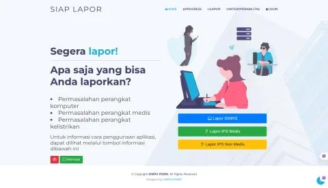
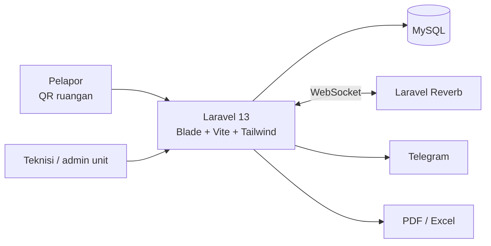

# SIAP LAPOR v2 — Pelaporan Kerusakan Instalasi SIMRS

> Aplikasi pelaporan kerusakan perangkat, jaringan, dan aplikasi di Instalasi SIMRS RSUD Mohammad Natsir Solok. Ditulis ulang dari versi PHP lama ([lapor-simrs-docs](https://github.com/izanmaizan/lapor-simrs-docs)) ke Laravel 13, dengan peta 3D perangkat, dashboard analitik, gudang dan permintaan barang, serta notifikasi real-time.

| | |
|---|---|
| Instansi | RSUD Mohammad Natsir Solok, Instalasi SIMRS |
| Peran saya | Analisis, desain, pengembangan end-to-end, migrasi data dan cutover |
| Pengguna | Seluruh ruangan RS (pelapor publik) dan teknisi SIMRS (hardware, jaringan, aplikasi) |
| Status | Produksi |

## Fitur utama

**Publik (tanpa login)**
- Form lapor kerusakan, bisa terisi otomatis dari QR ruangan/perangkat.
- Pantau status laporan per ruangan.
- Pengumuman SIMRS tampil sebagai popup di beranda.

**Petugas**
- Laporan masuk dan oper tugas ke teknisi; teknisi hanya melihat tugasnya.
- Detail penanganan, foto, perbaikan, dan **Kartu Perbaikan** (PDF).
- **Inventaris perangkat dan Peta 3D** (Three.js): editor denah gedung/lantai, penempatan perangkat, catatan maintenance, pencarian dan petunjuk jalan.
- **Gudang**: stok barang, mutasi stok, permintaan barang dan surat permintaan.
- **Dashboard analitik**: status laporan, rata-rata waktu respon dan selesai, tren 12 bulan, maintenance jatuh tempo, stok menipis.
- **Laporan bulanan dan LAKIP** dengan pratinjau cetak A4, tanda tangan gambar atau QR yang bisa diverifikasi publik.
- **Rekap dan ekspor** per ruangan/petugas/jenis/unit ke PDF dan Excel.
- Notifikasi real-time dengan bunyi melalui Laravel Reverb (otomatis jatuh ke polling bila WebSocket mati), plus Telegram.
- Peran dan izin, autentikasi dua faktor dan passkey.

## Arsitektur

## Model data (ringkas)

`units` · `ruangan` · `gedung` / `lantai` · `perangkat` · `kategori_perangkat` · `perangkat_log` · `peta_objek` · `laporan` · `laporan_foto` · `barang` / `stok` · `mutasi_stok` · `permintaan_barang` · `surat_permintaan` · `laporan_kinerja` · `tanda_tangan` · `pengumuman` · `pengaturan`

## Kualitas dan migrasi

- 60+ feature test (PHPUnit) untuk alur utama.
- Migrasi dari aplikasi lama: import data lama, uji paralel di sub-path, cutover, dan rencana rollback terdokumentasi dalam runbook.
- Bisa dilayani di root domain maupun sub-path di balik reverse proxy.

## Tech stack

| Lapis | Teknologi |
|---|---|
| Aplikasi | Laravel 13 (PHP), Blade, Vite |
| UI | Tailwind CSS, Three.js (peta 3D) |
| Data | MySQL |
| Real-time | Laravel Reverb (WebSocket), fallback polling |
| Deploy | Docker Compose, CI/CD |

---

> **Catatan kerahasiaan.** Kode sumber aplikasi ini private karena milik/dipakai instansi. Repo ini hanya menjelaskan konteks, fitur, arsitektur, dan peran saya. Tidak ada kode, data pegawai, data pasien, alamat server, maupun kredensial di sini.

**Maizan Insani Akbar** · Software Engineer & System Analyst · [Portfolio](https://izanmaizan.vercel.app) · [LinkedIn](https://www.linkedin.com/in/izanmaizan/) · [GitHub](https://github.com/izanmaizan)
